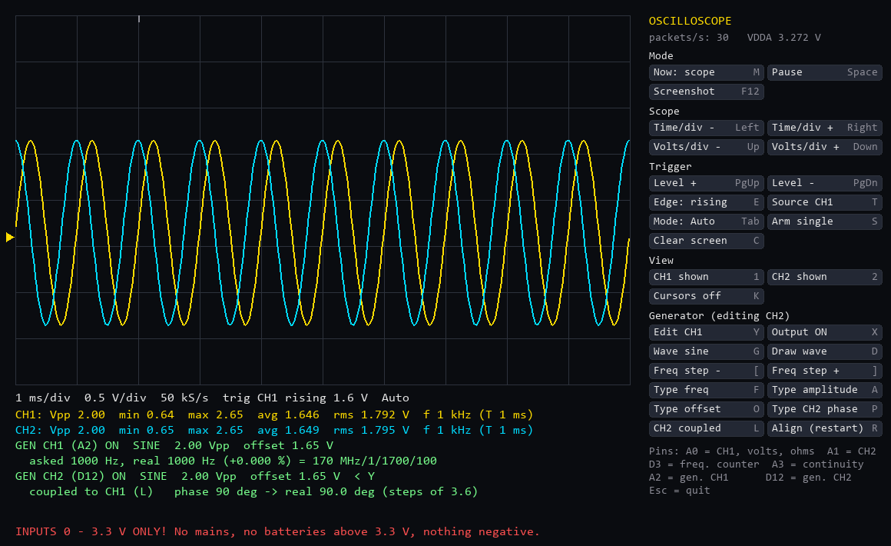
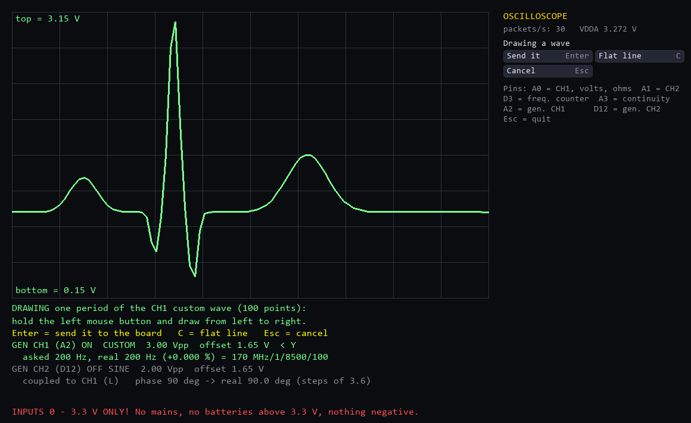
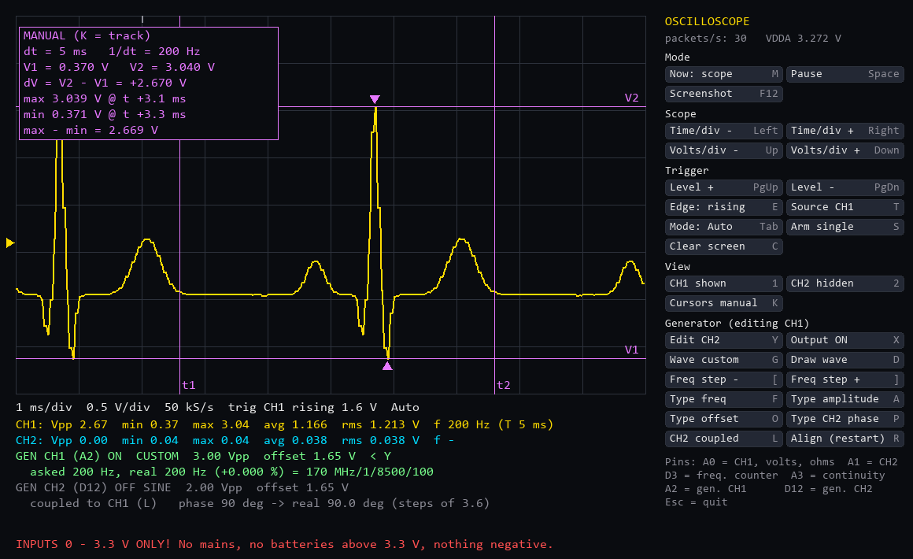
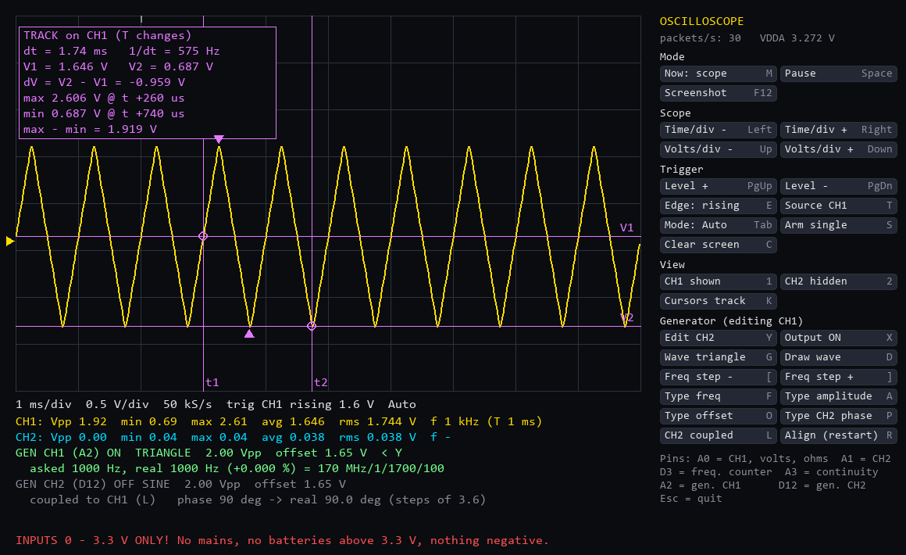

# Function generator + oscilloscope on a NUCLEO-G474RE

A **function generator** is the opposite of an oscilloscope: it does not
measure signals, it **makes** them. This project turns pins **A2** (CH1)
and **D12** (CH2) of a NUCLEO-G474RE into a small **two-channel** function
generator. For each channel the PC chooses the wave (**sine, square,
triangle, sawtooth**, or a **custom** wave you draw with the mouse), the
**frequency** (1 Hz to 10 kHz), the **amplitude** and the **offset** (DC
level), all between 0 and 3.3 V. CH2 can also be **shifted in phase**
against CH1 (for example 90°).

It is a copy of the SCOPE project, so the 2-channel **oscilloscope** and the
**multimeter** are still there. With **two jumper wires, A2 → A0 and
D12 → A1**, you watch the waves you make in the same window.

> ## ⚠️ SAFETY: 0 V to 3.3 V ONLY
> Every input pin goes **straight into the STM32 chip**. There is no
> protection at all. **Never** connect mains (230 V / 110 V), a car battery,
> a 5 V / 9 V / 12 V supply, a phone charger output, or anything negative.
> Doing that can destroy the board **and the USB port of your PC**.
> The generator outputs A2 and D12 only make 0 to 3.3 V. Don't connect
> them to another output, or to anything that has its own supply.


*(A real screenshot: the generator makes a 500 Hz triangle, 2.5 V peak to
peak around 1.65 V, and CH1 shows it. The green lines at the bottom are the
generator panel; the buttons on the right do the same as the keys. The
board data was read out through the debugger (the serial port was busy at
the time) and drawn by this window, so with the wire A2 → A0 you get the
same picture. [Here is a 300 Hz sawtooth](docs/screenshot_sawtooth.png).)*

```
 PC: "triangle, 500 Hz, 2.5 V, 1.65 V" ──USB──► board fills a table (100 values)
                                                     │
              TIM7 ticks ──► DMA copies the next value ──► DAC1 ──► A2  ──wire──► A0 (scope CH1)
  TIM3 (or TIM7) ticks ──► DMA copies the next value ──► DAC2 ──► D12 ──wire──► A1 (scope CH2)
```

## What it can do

**Function generator** (CH1 on A2, CH2 on D12; each channel has all of
the settings below, and its own **on/off**)
- Waves: **sine, square, triangle, sawtooth, custom** (one period you
  draw with the mouse, see [Draw your own wave](#draw-your-own-wave-d)).
- Frequency: **1 Hz to 10 000 Hz**, in steps of 1 Hz. The board makes the
  closest frequency its timer allows. The window shows that **real**
  frequency next to the one you asked for (see
  [Where the frequency comes from](#where-the-frequency-comes-from)).
- Amplitude (peak to peak) and offset (the middle level): **0 to 3.3 V**,
  in steps of 1 mV. If the wave would go below 0 V or above the supply, it
  is cut flat ("clipped") and the window says **CLIPPED**.
- **CH2 phase** 0 … 359° against CH1, in steps of 3.6°, while CH2 is
  **coupled** to CH1 (same frequency). Uncoupled, CH2 has its own frequency
  (see [Two channels, phase and coupling](#two-channels-phase-and-coupling)).
- Start-up setting: CH1 sine, 1 kHz, 2.0 V peak to peak, offset 1.65 V
  (from 0.65 V to 2.65 V). CH2 the same, but **off** (0 V) and coupled with
  phase 0°.

**Oscilloscope** (A0 and A1) and **multimeter** (volts and Ω on A0,
frequency on D3, continuity on A3): as in SCOPE. 1 kS/s to 2 MS/s,
trigger with Auto / Normal / Single. New: **automatic measurements** for
each channel (Vpp, min, max, average, RMS, frequency) and **cursors** you
drag with the mouse.

## Pins

All of them are on the Arduino-style headers of the Nucleo.

| Nucleo pin | Chip pin | Use |
|------------|----------|-----|
| **A2**     | PA4      | **Generator CH1 output** (DAC1) |
| **D12**    | PA6      | **Generator CH2 output** (DAC2) |
| **A0**     | PA0      | Scope CH1, voltmeter and ohmmeter input |
| **A1**     | PA1      | Scope CH2 |
| **D3**     | PB3      | Frequency / duty cycle input |
| **A3**     | PB0      | Continuity probe (other probe: **GND**) |
| 3V3        | –        | 3.3 V (only for the ohmmeter's known resistor) |
| GND        | –        | Ground (several GND pins on the headers) |

LED LD2 blinks each time a packet goes to the PC: "I'm alive".

## Try it (2 jumper wires)

```
   A2  (generator CH1) ───wire───► A0 (scope CH1)
   D12 (generator CH2) ───wire───► A1 (scope CH2)
```

Then start the PC window (below). Press **G** to change the wave and
**[** / **]** to change the frequency. You see the result on the scope at
once. These keys change CH1; press **Y** to change CH2 instead, and **X**
to switch it on.

Ideas to try:
- **Y**, **X** (CH2 on), **P** `90` **Enter**: two sines a quarter period
  apart, like the screenshot in
  [Two channels, phase and coupling](#two-channels-phase-and-coupling).
- Press **F**, type `440`, **Enter**: the note A. The window says
  "real 439.959 Hz". Why not 440? See the next section.
- Make a square wave from 0 V to 3.3 V (**A** `3.3`, **O** `1.65`) and wire
  A2 (or D12, if that channel makes the square) → **D3**. Press **M**: the
  frequency counter measures your generator.
- Set the offset to 3.0 V with 2 V amplitude: the top is cut off at the
  supply (CLIPPED). A real generator does the same at its limits.

## Where the frequency comes from

The board does not "know" a frequency. It has a **table** with one period of
the wave in it (100 values), and a **timer** (TIM7) that ticks at a fixed
speed. On every tick, the **DMA** copies the next table value into the
**DAC**, and the DAC puts that voltage on A2. After 100 ticks one period is
done, and it starts again. So:

```
   frequency = 170 MHz / (PSC + 1) / (ARR + 1) / 100

   170 MHz = the chip's clock, which also drives TIM7
   PSC + 1 = the timer's "prescaler": it divides the clock first (1..65536)
   ARR + 1 = the timer counts 0, 1, ..., ARR, then ticks: it divides again (1..65536)
   100     = table values in one period
```

PSC and ARR are **whole numbers**, so only some frequencies can be made
exactly. The board picks the closest one.

**Worked example: 440 Hz**
1. Values per second needed: 440 × 100 = 44 000.
2. Timer counts per value: 170 000 000 / 44 000 = **3863.6**. Not a whole
   number, so round it: **3864**.
3. That fits in one timer (up to 65 536), so PSC + 1 = 1 and ARR + 1 = 3864,
   so **PSC = 0, ARR = 3863**.
4. Real frequency: 170 000 000 / 1 / 3864 / 100 = **439.959 Hz**, 0.009 %
   too low. Nobody can hear that.

**Worked example: 1 Hz** (needs a slower timer)
1. Counts per value: 170 000 000 / 100 = **1 700 000**. Too big for ARR
   (at most 65 536), so the prescaler must divide too.
2. Smallest prescaler that fits: 1 700 000 / 65 536 = 25.9 → PSC + 1 = **26**.
3. ARR + 1 = 1 700 000 / 26 = 65 384.6 → **65 385**.
4. Real: 170 000 000 / 26 / 65 385 / 100 = **0.999991 Hz**. The window
   shows exactly this, with PSC + 1 = 26 and ARR + 1 = 65 385.

**Higher frequency, bigger rounding.** At 7000 Hz the timer counts only
242.86 per value. That rounds to 243 → **6995.9 Hz** (−0.06 %). The fewer the
counts, the bigger one count is. At 10 000 Hz it is 170 counts, exactly.

**Why at most 10 kHz?** At 10 kHz the DAC gets 10 000 × 100 = **1 000 000
values a second**, the most this DAC (with its output buffer) is made for.
Faster would need fewer table values, so the waves would look like stairs.
We keep it simple: always 100 values, and the timer changes speed.

## 1. Build and flash the board (STM32CubeIDE)

1. *File → Import… → General → Existing Projects into Workspace → Next*.
2. *Select root directory*: `...\STM Projects\FUNCGEN\FuncGen`. Tick
   **FuncGen**, then *Finish*. (It has its own name, so it can sit in the same
   workspace as **Scope**.)
3. Build with the hammer button. You should get 0 errors and 0 warnings.
4. Plug in the Nucleo, then *Run → Run* (the green play button). When it
   asks, choose *STM32 C/C++ Application* and *OK*.

There is only one board, so flashing FuncGen replaces Scope on it (and back
again). FuncGen can do everything Scope can.

To change pins or timers, open `FuncGen.ioc` (CubeMX), edit, save and let it
generate code. Our own code is in `generator.c`, `scope.c` and the
`USER CODE` sections of `main.c`, so it is kept.

## 2. Run the PC window

```
cd pc_app
py -m pip install -r requirements.txt
py funcgen_window.py
```

It finds the board's COM port by itself. If not, use
`py funcgen_window.py --port COM4` (Device Manager → *Ports* shows the
"STMicroelectronics STLink Virtual COM Port").

Close the window before flashing the board again. Only one program can use
the COM port at a time.

## Controls

**Buttons or keys, your choice.** Every key below also has a button in
the panel on the right of the window, grouped as Mode, Scope, Trigger,
View and Generator. Each button says what it does, with its key in grey on
the right (for example `Wave sine   G`). Click it with the mouse and the
window does exactly what the key does. Toggle buttons show the current
state ("Mode: Auto", "Edge: rising", "CH2 shown", "Edit CH2", "Output ON",
"CH2 coupled"). While you draw a wave the panel shows only **Send it /
Flat line / Cancel**, and while you type a value it shows **OK / Cancel /
Delete digit** (type the digits on the keyboard). Esc on the keyboard
still quits the window; the Cancel button never does.

**Generator** (the green lines under the scope show both channels; `< Y`
marks the one the keys change)

| Key | Does |
|-----|------|
| **Y** | Choose the channel the generator keys change: CH1 (A2) ↔ CH2 (D12) |
| **X** | That channel's output on / off (off = 0 V) |
| **G** | Next wave: sine → square → triangle → sawtooth → custom → sine |
| **D** | Draw your own wave with the mouse (see below) |
| **[** / **]** | Frequency down / up in 1-2-5 steps (1, 2, 5, 10, 20, 50, ... 10 000 Hz) |
| **F** | Type a frequency in Hz, then **Enter** (1 to 10 000) |
| **A** | Type the amplitude in volts peak to peak, then **Enter** (0 to 3.3) |
| **O** | Type the offset (middle level) in volts, then **Enter** (0 to 3.3) |
| **P** | Type CH2's phase in degrees, then **Enter** (0 to 359) |
| **L** | CH2 coupled to CH1 (same frequency, phase works) or not (own frequency) |
| **R** | Align: restart both channels together |
| Esc | While typing: cancel. Backspace deletes a digit |

Out-of-range numbers are set to the nearest limit. The panel shows:

```
GEN CH1 (A2) ON  TRIANGLE  2.50 Vpp  offset 1.65 V
  asked 500 Hz, real 500 Hz (+0.000 %) = 170 MHz/1/3400/100
GEN CH2 (D12) ON  SINE  2.00 Vpp  offset 1.65 V  < Y
  coupled to CH1 (L)   phase 90 deg -> real 90.0 deg (steps of 3.6)
```

The last number in "170 MHz/1/3400/100" is the table size; the others are
PSC + 1 and ARR + 1 (see the formula above). While CH2 is coupled, its
frequency is CH1's, so its line shows the phase instead.

A new setting is used at the start of the board's next capture. At slow
time/div (50 ms/div) that can take up to a second.

### Two channels, phase and coupling



*(Real data from the board: both channels make a 1 kHz sine, 2 Vpp around
1.65 V, with CH2 (cyan) set to 90°. CH2 reaches its top a quarter period
(0.25 ms) **before** CH1 (yellow): it is 90° **ahead**. Wires A2 → A0 and
D12 → A1. The samples were read out of the board through the debugger,
because another program had the COM port, and drawn by this window.)*

Each channel has its own wave, frequency, amplitude, offset, on/off and
custom drawing. **Y** chooses which one the generator keys change.

**Coupled** (the default, **L** switches): CH2 uses CH1's timer, so it
always has exactly CH1's frequency (its own frequency setting is kept for
later, but not used). Now **P** can shift CH2: its table simply starts
somewhere else. With 90°, CH2 starts at point 25 of its 100 (90 / 360 × 100
= 25). One point = 360° / 100 = **3.6°**, so the phase is rounded to the
nearest 3.6° (45° becomes 46.8°; the window shows the real value). This is
how real two-channel generators work too.

**Not coupled**: CH2 has its own timer and frequency. Two different
frequencies keep sliding past each other, so a phase means nothing: the
window shows "phase n/a". Even two "equal" frequencies drift a little.

**R** (align) restarts both channels at the same moment. Any change to
either channel does that too, so CH1 hiccups briefly when you change CH2.

Phase measured on this board (CH1 and CH2 1 kHz sines, coupled; phase
from fitting a sine to 1000 samples of each channel):

| Set | Board makes | Measured |
|----:|------------:|---------:|
| 0° | 0.0° | 0.0° |
| 45° | 46.8° | 46.8° |
| 90° | 90.0° | 90.0° |
| 180° | 180.0° | 180.0° |
| 270° | 270.0° | 270.0° |

### Draw your own wave (D)



1. Press **D**. The scope picture is replaced by a drawing area that starts
   with the current custom wave (at first: 4 stairs).
2. Hold the **left mouse button** and draw **one period**, from left to
   right. You can go over parts again. **C** starts from a flat line.
3. Press **Enter**: the window turns your drawing into 100 points, sends
   them to the board, and switches the generator to **custom**. (This is for
   the channel chosen with **Y**; each channel keeps its own drawing.)
   **Esc** cancels and keeps the old wave.

**Amplitude and offset still work** on a drawn wave: the top of the
drawing area is `offset + amplitude / 2`, the bottom is
`offset − amplitude / 2` (the labels "top = ..." and "bottom = ..." show
the values). So you can draw once and then make it bigger, smaller or
higher with **A** and **O**, and faster with **[ ]** / **F**, just like the
other waves. For the full 0 … 3.3 V use amplitude 3.3 and offset 1.65.



*(Real screenshot of a drawn "heartbeat", 200 Hz, 3.0 Vpp. Cursors t1/t2
measure one period: dt = 5 ms, 1/dt = 200 Hz. V1/V2 sit on the bottom and
the top: dV = 2.67 V. Board data read through the debugger, like the first
screenshot.)*

### Cursors and automatic measurements

Under the scope, one line per channel is measured from the samples
on screen:

```
CH1: Vpp 2.67  min 0.37  max 3.04  avg 1.166  rms 1.213 V  f 200 Hz (T 5 ms)
```

- **Vpp** = max − min. **avg** = the average (the DC level).
- **rms** = √(average of v²). It **includes** the DC level, so a 2 Vpp sine
  around 1.65 V gives about 1.80 V, not 0.71 V.
- **f** counts how often the signal goes up through its middle. It needs at
  least 2 periods on screen; otherwise it shows "-".

Press **K** to show the **cursors**: two vertical lines **t1 / t2** and two
horizontal lines **V1 / V2**. Drag any of them with the left mouse button.
The box at the top left shows **dt** (time between t1 and t2), **1/dt**
(the frequency, if dt is one period) and **dV** = V2 − V1.

Press **K** again for **track** mode, like on a real scope: you drag only
t1 / t2, and V1 / V2 jump by themselves to the wave's voltage at t1 and t2
(a small ring marks each point). They follow the wave as it changes. Track
uses the trigger channel; **T** switches between CH1 and CH2. The box shows
"MANUAL" or "TRACK on CH1". A third **K** hides the cursors.

**Max / min between the cursors:** while the cursors are on (manual or
track), the window also searches the trigger channel **between t1 and t2**
for its highest and lowest sample. A small ▼ marks the max and a ▲ the
min. The box adds "max 2.650 V @ t +400 us" (time after the left-hand
cursor), the same for min, and "max − min". Move t1 / t2 around one bump
to measure just that bump.



*(Track mode on a real 1 kHz triangle from the board: V1 / V2 are the
wave's voltage at t1 / t2, and ▼ / ▲ mark the max and min between them.)*

**Scope and meter** (same as SCOPE)

| Key | Does |
|-----|------|
| **M** | Switch between oscilloscope and multimeter |
| ← / → | Time/div: faster / slower |
| ↑ / ↓ | Volts/div: zoom in / out |
| PgUp / PgDn | Trigger level ±0.1 V |
| E | Trigger on rising or falling edge |
| T | Trigger on CH1 or CH2 |
| Tab | Trigger mode: Auto → Normal → Single |
| S | Arm a Single capture (again) |
| C | Clear the screen |
| 1 / 2 | Show / hide CH1 / CH2 |
| **K** | Cursors: off → manual (drag all 4 lines) → track (V1/V2 follow the wave) → off |
| Space | Pause |
| F12 | Save `screenshot.png` |
| Esc | Quit |

Tip: for a nice picture, choose a time/div that shows 2 to 5 periods. For
1 kHz that is 0.5 or 1 ms/div. Trigger level 1.6 V works with the default
offset of 1.65 V.

## Measured on this board

The board's own ADC measured the generator (test build: A2 read inside the
chip, 1000 samples, the time between crossings of the middle level).

| Setting | Formula says | Measured | Difference |
|---------|-------------:|---------:|-----------:|
| sine 1 kHz | 1000.000 Hz | 1000.001 Hz | +1 ppm |
| sine 440 Hz | 439.959 Hz | 439.960 Hz | +3 ppm |
| triangle 7 kHz | 6995.885 Hz | 6996.49 Hz | +86 ppm |
| square 3 kHz | 2998.236 Hz | 2998.78 Hz | +180 ppm |
| sawtooth 10 kHz | 10 000.000 Hz | 10 000.03 Hz | +3 ppm |
| sine 50 Hz | 50.0000 Hz | 50.0000 Hz | −1 ppm |
| sine 5 Hz | 5.0000 Hz | 5.0014 Hz | +294 ppm |

(1 ppm = 0.0001 %.) The small differences come from the **measurement**
(only a few periods fit in one capture), not from the generator: the
generator is exactly the formula. The **real** frequency is "formula ± the
error of the chip's clock". The clock is the chip's internal oscillator,
±1 % at most, often much better. The scope uses the same clock, so it cannot
see that error. You'd need a better instrument for that.

| Voltage test | Measured |
|--------------|----------|
| 2.0 Vpp around 1.65 V (sine/triangle/square) | 0.647 to 2.650 V |
| 3.3 Vpp around 1.65 V (full range) | 0.038 to 3.272 V (VDDA = 3.272 V) |
| square 0.5 Vpp around 0.25 V | 0.038 to 0.501 V (the DAC's "0 V" comes out as about 0.04 V) |
| sine 1 Vpp around 3.0 V | 2.498 to 3.272 V (the top is clipped at the supply) |

So the output really goes from about **0.04 V to the supply (3.27 V)**.
The "3.3 V" is really the board's supply, about 3.27 V from USB; the board
measures it at start-up and scales the table to it.

## Limits (it's a learning tool, not a real instrument)

- 1 Hz to 10 kHz, 0 to 3.3 V, no negative voltages.
- Always 100 values per period: a 10 kHz sine is 100 small steps. Fine for
  the scope; a real generator would add a filter to smooth them.
- The output can't drive much current. Connect it to inputs (like A0), not
  to a speaker or an LED without a resistor of at least 1 kΩ.
- The output reaches about 0.04 V at the bottom, not exactly 0 V.
- When you change a setting, both channels stop for a moment and restart
  at the beginning of their tables (that keeps the phase right).
- CH2's phase only works while it is coupled to CH1, in steps of 3.6°.
- Frequency accuracy: the formula is exact; the chip's clock is ±1 %.
- A drawn wave has 100 points with 256 levels each (0 … 255). Sharp jumps
  in a drawing are fine, but a fast mouse can't draw finer detail than
  1/100 of a period.
- The board forgets a drawn wave when it is reset (it starts with the
  4 stairs). The window notices and sends its drawing again when you
  choose "custom".

## Files

```
FUNCGEN/
├── README.md                     this file
├── HOW_IT_WORKS.md               the code, explained step by step
├── docs/screenshot.png           triangle on the scope (screenshot_sawtooth.png: sawtooth,
│                                 screenshot_draw.png / screenshot_custom.png: a drawn wave,
│                                 screenshot_dual.png: CH1 and CH2 90° apart)
├── pc_app/
│   ├── funcgen_window.py         the PC window (pygame): scope, meter, cursors, generator panel, drawing
│   └── requirements.txt
└── FuncGen/                      STM32CubeIDE project
    ├── FuncGen.ioc               CubeMX settings (pins, ADCs, DACs, timers, DMA, UART)
    └── Core/
        ├── Src/main.c            generated; our lines are in USER CODE
        ├── Src/generator.c       NEW: 2 channels: table -> DMA -> DAC, timer maths, phase
        ├── Inc/generator.h       NEW: wave names and limits
        ├── Src/scope.c           capture + measure + send; receives 'G', 'W' and 'P' commands
        └── Inc/scope.h
```
