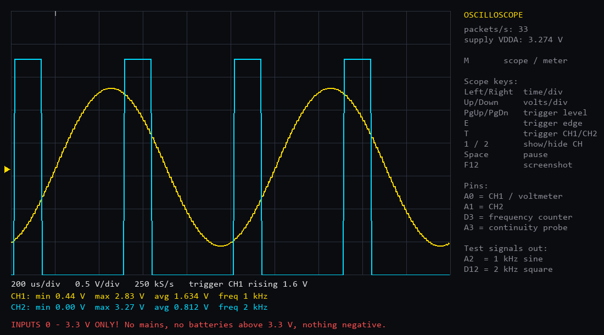

# Oscilloscope + multimeter on a NUCLEO-G474RE

A small 2-channel **oscilloscope** and a simple **multimeter**, made with only
a NUCLEO-G474RE, a few jumper wires and the USB cable. The **board measures**;
the **PC is the screen**.

> ## ⚠️ SAFETY: inputs 0 V to 3.3 V ONLY
> Every input pin goes **straight into the STM32 chip**. There is no
> protection at all. **Never** connect mains (230 V / 110 V), a car battery,
> a 5 V / 9 V / 12 V supply, a phone charger output, or anything negative.
> Doing that can destroy the board **and the USB port of your PC**.
> Measure only things powered by the Nucleo's own 3.3 V, like the built-in
> test signals below. When in doubt, don't connect it.



*(A real screenshot: CH1 (yellow) is the board's 1 kHz sine and CH2 (cyan)
is its 2 kHz square, at 200 µs/div. It was taken with a temporary test build
that routed both test signals inside the chip, because nobody was there to
plug in the wires. With the normal firmware and the two wires from "Try it",
you get the same picture.)*

```
 signal (0..3.3 V) ──► A0 / A1 ──► ADC1 + ADC2 ──DMA──► memory ──USB──► PC window
                                    (2 000 000 samples/s max)            scope or meter
```

## What it can do

**Oscilloscope** (2 channels, A0 and A1)
- From 1 000 to 2 000 000 samples per second on each channel. Both channels
  are sampled at the same moment.
- 12 bits (0..4095), 0 to 3.3 V.
- Time/div from 50 ms to 25 µs; volts/div 0.1 / 0.2 / 0.5 / 1 V.
- Trigger: on CH1 or CH2, rising or falling edge, with an adjustable level.
  Modes Auto / Normal / Single, like a real scope.
- Shows min / max / average and the frequency of each channel.

**Multimeter**
- **DC voltage** on A0: the average of 1000 samples. It is calibrated with
  the chip's internal reference (VREFINT), so the result does not depend on
  the exact USB voltage.
- **Frequency + duty cycle** on D3: a 170 MHz hardware timer measures each
  period. It works from about 1 Hz to a few MHz.
- **Continuity** on A3: touch A3 to GND through what you test, and the PC
  beeps. (It beeps below roughly 10 to 20 kΩ, because the chip's internal
  pull-up resistor is about 40 kΩ.)
- **Resistance (Ω)** on A0, with one known resistor (10 kΩ): see
  [Measuring resistors](#measuring-resistors-ω).

**Test signals** (the board makes them, so you have something to measure)
- **A2**: 1 kHz sine wave, from 0.44 V to 2.83 V (DAC)
- **D12**: 2 kHz square wave, 0 V / 3.3 V, high 25 % of the time (timer PWM)

## Pins

All of them are on the Arduino-style headers of the Nucleo.

| Nucleo pin | Chip pin | Use |
|------------|----------|-----|
| **A0**     | PA0      | Scope CH1, voltmeter **and** ohmmeter input |
| 3V3        | –        | 3.3 V supply (only for the known resistor of the ohmmeter) |
| **A1**     | PA1      | Scope CH2 |
| **D3**     | PB3      | Frequency / duty cycle input |
| **A3**     | PB0      | Continuity probe (other probe: **GND**) |
| **A2**     | PA4      | Test output: 1 kHz sine |
| **D12**    | PA6      | Test output: 2 kHz square |
| GND        | –        | Ground (several GND pins on the headers) |

LED LD2 blinks each time a packet goes to the PC: "I'm alive".

## Try it (only 2 jumper wires)

```
   Scope:             A2 (sine)    ───wire───► A0 (CH1)
                      D12 (square) ───wire───► A1 (CH2)

   Multimeter:        A2 (sine)    ───wire───► A0       (shows ~1.63 V, the average)
                      D12 (square) ───wire───► D3       (shows 2 kHz, 25 %)
                      A3  ───wire───► GND               (beep!)
```

With nothing connected, the inputs "float" and pick up the 50 Hz hum from the
mains wiring in the room. Touch A0 with your finger to see it get bigger.
That is normal.

## Measuring resistors (Ω)

You need **one resistor you know**, e.g. 10 kΩ (brown-black-orange). Build a
"voltage divider" on a breadboard, or just twist the legs together:

```
   3V3 pin ──── known 10 kΩ ────┬──── resistor to measure ──── GND pin
                                │
                                A0
```

Exact jumpers: the pin labelled **3V3** on the power header (CN6, next to
5V and GND) → one leg of the 10 kΩ. Its other leg → **A0** **and** one leg of the unknown resistor. The
unknown resistor's other leg → **GND**. Press **M** for multimeter mode and
read the *Resistance* line. (Remove the A2 → A0 test wire first!)

**How it works:** the same current flows through both resistors, so the
voltage splits in the same ratio as the resistances:

```
   R_unknown = R_known × V(A0) / (VDDA − V(A0))
```

VDDA is the real supply (≈ 3.27 V), measured with VREFINT, so the result
doesn't depend on the exact USB voltage. Example: 10 kΩ + 4.7 kΩ gives
V(A0) = 3.274 × 4.7 / 14.7 = 1.047 V → 10 kΩ × 1.047 / 2.227 = **4.7 kΩ**.

- **Best range: 1 kΩ to 100 kΩ** (R_known ÷ 10 to × 10). Outside it, the
  screen says "less accurate": one ADC step is then a big part of the result.
- **open**: nothing between A0 and GND (V(A0) ≈ VDDA).
- **short (<101 Ω)**: A0 is (almost) at GND.
- The result is only as exact as your known resistor (often ±1 % or ±5 %).
  For better results, use `--rref` with its exact value (see below).
- Using another known resistor (e.g. 4.7 kΩ): start the window with
  `py scope_window.py --rref 4700`. The screen shows which value it uses.
- Check: two 10 kΩ resistors from the same bag should read about 10 kΩ.
- Without the divider wired, the Resistance line shows nonsense. Only the
  voltmeter line makes sense then.
- Measure resistors **out of the circuit** (not soldered into something
  powered).

**Colour bands** (4-band resistor, read from the side *away* from the gold
or silver band): 1st digit, 2nd digit, then the multiplier (number of zeros).
Colours: black 0, brown 1, red 2, orange 3, yellow 4, green 5, blue 6,
violet 7, grey 8, white 9. Gold = ±5 %, brown (last band) = ±1 %.
Examples: brown-black-orange = 1 0 + 000 = **10 kΩ**;
yellow-violet-red = 4 7 + 00 = **4.7 kΩ**; brown-black-red = **1 kΩ**.

## 1. Build and flash the board (STM32CubeIDE)

1. *File → Import… → General → Existing Projects into Workspace → Next*.
2. *Select root directory*: `...\STM Projects\SCOPE\Scope`. Tick **Scope**,
   then *Finish*.
3. Build with the hammer button. You should get 0 errors and 0 warnings.
4. Plug in the Nucleo, then *Run → Run* (the green play button). When it
   asks, choose *STM32 C/C++ Application* and *OK*.

To change pins or timers, open `Scope.ioc` (CubeMX), edit, save and let it
generate code. Our own code is in `scope.c`, `test_signals.c` and the
`USER CODE` sections of `main.c`, so it is kept.

## 2. Run the PC window

```
cd pc_app
py -m pip install -r requirements.txt
py scope_window.py
```

It finds the board's COM port by itself. If not, use
`py scope_window.py --port COM4` (Device Manager → *Ports* shows the
"STMicroelectronics STLink Virtual COM Port").

Close the window before flashing the board again. Only one program can use
the COM port at a time.

## Controls

| Key | Does |
|-----|------|
| **M** | Switch between oscilloscope and multimeter |
| ← / → | Time/div: faster / slower (changes the board's sample rate) |
| ↑ / ↓ | Volts/div: zoom in / out |
| PgUp / PgDn | Trigger level ±0.1 V (the small arrow on the left) |
| E | Trigger on rising or falling edge |
| T | Trigger on CH1 or CH2 |
| Tab | Trigger mode: Auto → Normal → Single |
| S | Arm a Single capture (again) |
| C | Clear the screen (until the next new capture) |
| 1 / 2 | Show / hide CH1 / CH2 |
| Space | Pause (freeze the picture) |
| F12 | Save `screenshot.png` |
| Esc | Quit |

If the text "(no trigger!)" appears, the wave never crosses the trigger
level. Move the level with PgUp/PgDn into the wave.

## Trigger modes (Tab)

The **trigger** is the moment the signal crosses the trigger level (the small
arrow on the left), going up (rising) or down (falling). The scope puts that
moment at 20 % of the screen (the small grey mark at the top), so you also
see what happened just *before* it.

| Mode | What the screen does | Good for |
|------|----------------------|----------|
| **Auto** (start) | Draws every capture. With a trigger, the wave stands still. Without one, it draws anyway ("no trigger!"). | Repeating waves; DC voltages (a flat line never "crosses" anything) |
| **Normal** | Draws **only** captures with a trigger. Otherwise it keeps the last one ("waiting for trigger"). | Signals that come and go |
| **Single** | Waits ("ARMED") for **one** trigger, then freezes ("STOPPED"). Press **S** to arm it again. | One-off events, like the battery below |

Press **C** to clear the screen. It stays empty until the mode draws a new
capture: in Auto at once, in Normal at the next trigger, and in Single only
after it is armed (C does not arm it; press S for that).

### Experiment: catch the moment you connect a battery

A flat DC voltage (a battery that is already connected) never crosses the
level, so it can't trigger. Only the **moment you connect it** is an edge,
and in Auto mode that picture is gone a moment later. Use Single:

1. Take **one** 1.5 V AA/AAA battery (never more than one, never reversed:
   **+ to A0**, **− to GND**). Hold a wire from **GND** on the **−** end.
2. Press **Tab** until it says *Single*, or press **S**.
3. Press **→** a few times to get **10 ms/div** (or 50 ms/div).
4. Leave CH1 / rising. Set the level to **1.0 V** with **PgDn**. A floating
   A0 picks up hum up to almost 0.9 V, so 1.0 V is safely above that and
   safely below 1.5 V.
5. Touch the wire from **A0** to the battery's **+** end. The screen freezes
   with the jump from ~0 V to 1.5 V at the grey mark: *STOPPED*.
   You may even see the contact "bounce" a few times.
6. Press **S** to try again.

(An edge right at the end of one capture is still caught: the PC glues that
capture to the next one. See HOW_IT_WORKS.md.)

## Measured on this board

| What | Result |
|------|--------|
| Fastest sampling | 2 000 000 samples/s on each channel (4 MS/s in total) |
| Screen updates | ~90/s at 2 MS/s, ~35/s at 50 kS/s, 9/s at 10 kS/s, 1/s at 1 kS/s |
| Supply VDDA (from VREFINT) | 3.272 to 3.274 V |
| Voltage accuracy | VREFINT read as 1213.8–1214.6 mV; the factory value is 1215.4 mV, so the error is about −0.1 % (≈ 1–2 mV) |
| Noise | about 0.3 mV (standard deviation) on a steady voltage |
| Sine (A2) | 0.437 to 2.832 V, 1000.0 Hz |
| Square (D12) | 2000.0 Hz, 25 % |
| Frequency counter | a 250 Hz / 25 % test signal read exactly 250.000 Hz, 25.00 % |

## Limitations (it's a learning tool, not a real instrument)

- **0 to 3.3 V only**: no negative voltages and no higher voltages. You
  would need a resistor divider plus protection circuits for that.
- Resistance needs one known resistor, and it is best between 1 kΩ and
  100 kΩ (with a 10 kΩ reference).
- 2 MS/s at most. A 1 kHz signal looks great; a 500 kHz signal is only
  4 points per period. 12 bits = steps of about 0.8 mV.
- At the slowest setting (50 ms/div), the picture updates once a second.
- The ADC needs time to charge its small sampling capacitor through your
  source. At slow rates (≤ 50 kS/s, which includes meter mode) it waits
  640.5 ADC cycles, so sources up to tens of kΩ (like the resistor divider)
  read correctly. At fast rates it must sample quickly (2 MS/s: only 6.5
  cycles), so sources above ~1 kΩ read too low there.
- The frequency counter needs a clean 0 / 3.3 V digital signal. A sine
  works only if it crosses the thresholds cleanly. Below ~1 Hz it shows
  "no signal".
- Continuity is a digital pin, not a real Ω measurement.

## Files

```
SCOPE/
├── README.md                   this file
├── HOW_IT_WORKS.md             the code, explained step by step
├── docs/screenshot.png         oscilloscope screen (screenshot_meter.png: multimeter)
├── pc_app/
│   ├── scope_window.py         the PC window (pygame)
│   └── requirements.txt
└── Scope/                      STM32CubeIDE project
    ├── Scope.ioc               CubeMX settings (pins, ADCs, timers, DMA, UART)
    └── Core/
        ├── Src/main.c          generated; our lines are in USER CODE
        ├── Src/scope.c         capture + measure + send to the PC
        ├── Inc/scope.h
        ├── Src/test_signals.c  sine (DAC) and square (PWM) outputs
        └── Inc/test_signals.h
```
